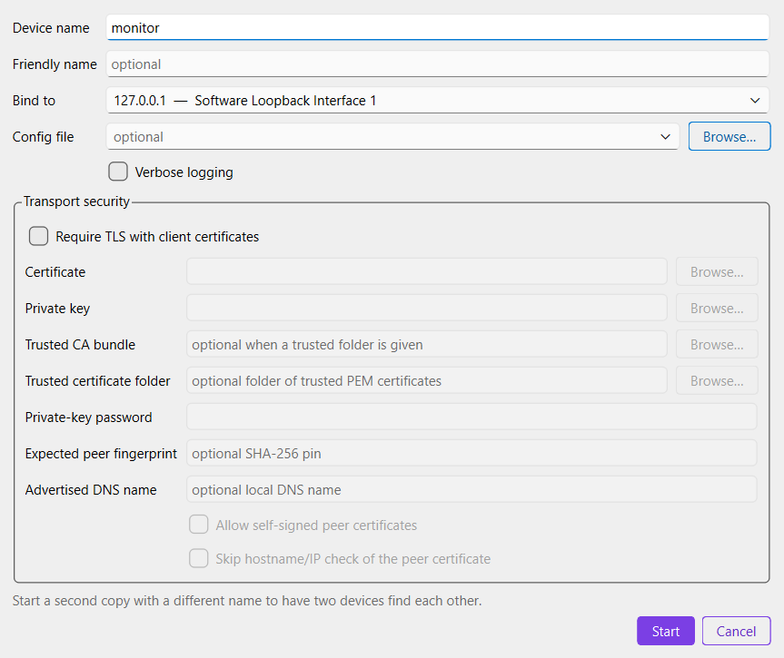
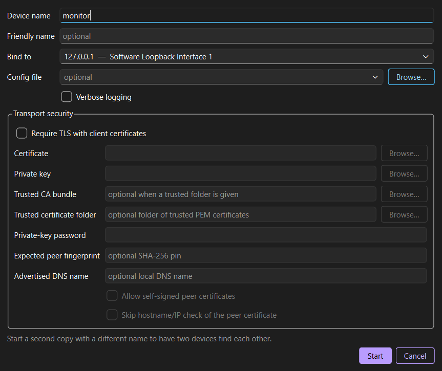
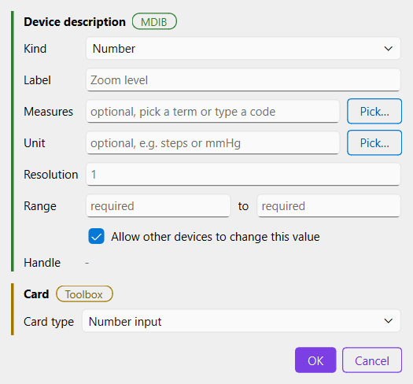
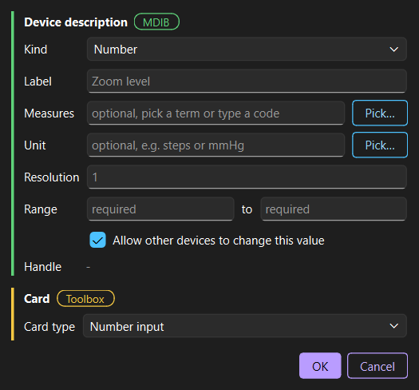
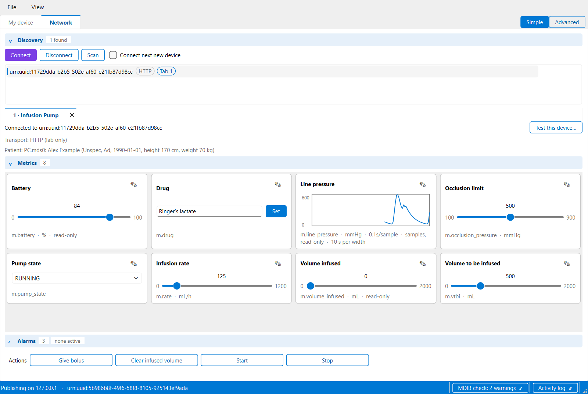
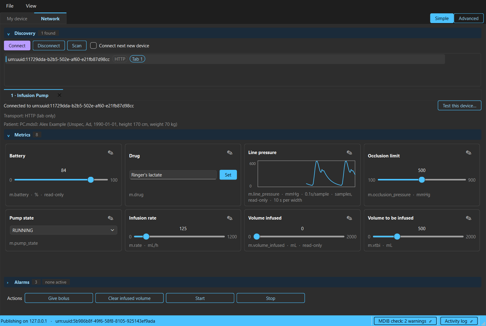

# Your first device
{: .no_toc }

In about ten minutes you build a device in one toolbox, connect to it from a second one, and see
the parts of SDC that make it interesting: values that update by themselves, writes the device can
refuse, and alarms that stay true after you acknowledge them.

1. TOC
{:toc}

## 1. Start two toolboxes

Every toolbox is two things at once: a device it publishes (**My device**) and a viewer for other
devices (**Network**). So you need two of them to see anything travel over the network. They can
run on the same computer.

Start the toolbox. It asks how to start:

{: .only-light }
{: .only-dark }

- **Name**: the device's name, for example `alpha`. The name decides the device's network identity
  (its EPR), so a device keeps its identity when you restart it under the same name. Two running
  toolboxes must have different names.
- **Address**: which network address discovery uses. Keep `127.0.0.1` while both toolboxes run on
  one computer. To reach another computer, pick the address of the network adapter it can reach.
- **Config**: leave it empty for now. Later you can pick one of the shipped presets here.

Press **Start**. Then start a second toolbox and name it `beta`.

{: .tip }
From a terminal, `run_toolbox.py --name alpha` starts without asking. See
[Command line](../reference/command-line.md).

## 2. Build a device in alpha

In **alpha**, on the **My device** tab, press **New data source…**:

{: .only-light }
{: .only-dark }

- **Kind**: Number.
- **Label**: `Zoom level`.
- **Range**: `1` to `100`. Every number needs one: it is the range the device can produce.
- Tick **Allow other devices to change this value**.

Press **OK**. A card appears with a slider, and the handle `m.zoom_level` underneath: the name the
value has inside the device. Move the slider; the value is published at once.

Add a second data source: **Kind** Choice, **Label** `Mode`, allowed values `IDLE`, `RUN` and
`PAUSE`, again with remote control allowed. It becomes a dropdown.

## 3. Connect from beta

In **beta**, open the **Network** tab and press **Scan**. After a few seconds alpha's device
appears in the list as `urn:uuid:…`. Select it and press **Connect** (or double-click it).

{: .only-light }
{: .only-dark }

beta now shows alpha's metrics as cards. Nobody told beta what *Zoom level* is: it read it from the
device's self-description, its **MDIB**. That is the point of SDC.

## 4. Watch values travel

- Move *Zoom level* in **alpha**. beta's card follows within a moment: alpha sends a report to
  every connected consumer when a value changes.
- Now move it in **beta**. beta asks alpha to set the value; alpha checks the request and answers.
  The status bar in beta shows alpha's answer, `Fin` when it is done.
- In **alpha**, open the card's pencil and switch remote control off. Try again from beta: alpha
  refuses, the value stays, and beta shows the reason alpha gave.
- In **alpha**, add another data source while beta is connected. It appears in beta without a
  reconnect, because a device can change its description while it runs.

## 5. Raise an alarm

In **alpha**, open the **Alarms** section and press **New alarm…**. Let it watch `m.zoom_level`,
call it `Zoom high`, and give it an upper limit of `80`.

Set *Zoom level* to 90. The alarm becomes *active*, and its signal icons turn red, in alpha and in
beta. Press **Acknowledge** in alpha: the icons go grey, but the alarm **stays active**.
Acknowledging changes how an alarm is announced, not whether it is true. Bring the value back
below 80 and the alarm clears.

## 6. Try a preset

*File > Load preset* in alpha replaces the device with a complete one: a patient monitor with ECG
and pleth waveforms, a ventilator, an infusion pump and more. beta has to connect again, because
the device it knew is gone. The presets show what a realistic device looks like; see
[Presets and files](../user-guide/presets-and-files.md).

## Where to go next

- [SDC in ten minutes](sdc-basics.md) explains what you just did in SDC terms.
- The [User guide](../user-guide/) explains every part of the window.
- [MDIB check](../user-guide/mdib-check.md) tells you what your device still lacks.
- [Advanced mode](../user-guide/advanced-mode.md) shows the messages on the wire and lets the
  device misbehave on purpose.
