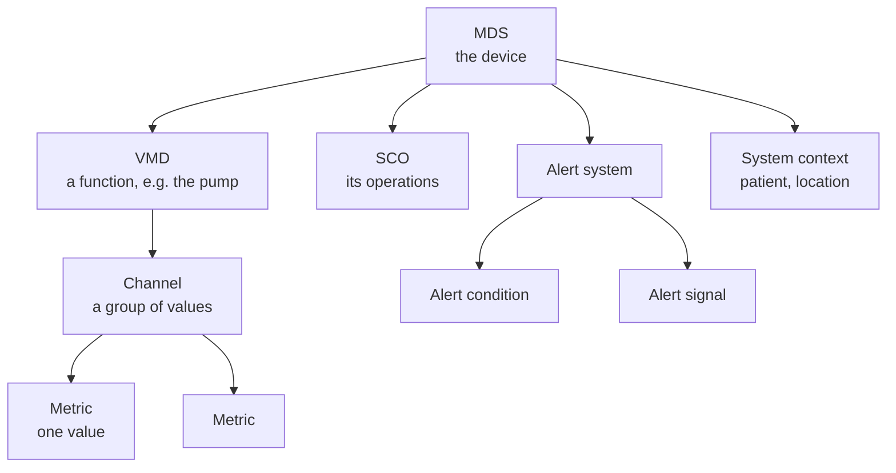

# SDC in ten minutes
{: .no_toc }

The ideas behind the toolbox, in the words the window uses. Each section ends with where you see
the idea in the toolbox.

1. TOC
{:toc}

## What SDC is

**IEEE 11073 SDC** (Service-oriented Device Connectivity) lets medical devices from different
manufacturers find each other on a network, describe themselves, exchange live data and control
each other, without a central server. It is a family of standards:

| Standard | What it defines |
|---|---|
| IEEE 11073-10207 (**BICEPS**) | the information model (the MDIB) and the services a device offers |
| IEEE 11073-20702 (**MDPWS**) | the web-services transport: SOAP over HTTP(S), WS-Discovery, WS-Eventing |
| IEEE 11073-20701 | how the two fit together, and discovery |
| IEEE 11073-10700, -10701, … | *participant key purposes*: what a device of a certain kind must provide |
| IEEE 11073-10101 (**MDC**) | the nomenclature: numeric codes for what is measured and in which unit |

A **provider** publishes a device. A **consumer** connects to a provider, reads it, subscribes to
its changes and may ask it to change things. The toolbox is both: **My device** is its provider,
**Network** its consumer.

## The MDIB: a device describes itself

Every provider holds a **Medical Device Information Base** (MDIB), its complete self-description,
in two halves:

- **MdDescription**: what the device *is*. A containment tree of *descriptors*.
- **MdState**: what everything *is right now*. One *state* per descriptor: values, alarm
  presences, whether an operation is enabled.

Every element has a **handle**, an id unique within the device, such as `m.heart_rate`. Every
change raises the **MdibVersion**, so a consumer can tell old news from new.

A consumer asks for the whole MDIB once (`GetMdib`) and then subscribes to reports of what
changes. When a device adds or removes a part while it runs, it sends a *description
modification report*, and the consumer updates its tree without reconnecting.

*In the toolbox:* the **MDIB structure** section (Advanced mode) shows the tree; point at an entry
to read what that kind of element is.

## Metrics: the values

BICEPS has exactly five kinds of metric, and the toolbox offers all five:

| BICEPS type | In the toolbox | Holds |
|---|---|---|
| `NumericMetric` | Number | one decimal value with a unit and a resolution |
| `StringMetric` | Text | free text |
| `EnumStringMetric` | Choice | one of a fixed list of values |
| `RealTimeSampleArrayMetric` | Waveform | samples over time, streamed in blocks |
| `DistributionSampleArrayMetric` | Distribution | samples over a domain, such as a spectrum |

There is no integer type (a whole number has resolution 1) and no boolean (a choice with two
values). A number's **TechnicalRange** is what the device can produce.

What a metric *is* comes from its **type**, a code from the MDC nomenclature such as
`MDC_PULS_RATE` (149514). The label "Pulse rate" is only for people; another device recognises
the code. The same goes for units: `MDC_DIM_BEAT_PER_MIN`, not the text "bpm".

*In the toolbox:* [My device](../user-guide/my-device.md), and
[Picking MDC codes](../user-guide/mdc-codes.md).

## Operations: changing a device from outside

A value is not writable because of a flag on it. Remote control is a separate **operation** in the
device's **SCO** (service control object) that points at the value through its
`OperationTarget`:

- a **SetValueOperation** sets a number, a **SetStringOperation** a text or a choice;
- an **ActivateOperation** makes the device *do* something, with nothing to write: *Start*,
  *Home axes*, *Give bolus*.

An operation's **OperatingMode** says whether it is enabled right now. Its **AllowedRange** says
what a consumer may ask for; it can be narrower than the TechnicalRange.

The device decides. A request is answered with an **InvocationState**: `Wait` and `Start` while
it works, then `Fin` (done), `FinMod` (done, but changed) or `Fail` with an error and a reason.

*In the toolbox:* the *remote control* tick of a data source, the editor on the Network tab, and
[Actions](../user-guide/actions.md).

## Alarms: conditions and signals

BICEPS separates two things that are easy to confuse:

- an **alert condition** is the fact: "the pressure is too high". It has a kind (physiological,
  technical, other) and a priority, and it is present or not. A **limit alert condition** watches
  a metric against limits by itself;
- an **alert signal** is how the fact is announced: visible, audible, tangible (vibration) or
  other. One condition can drive several signals.

**Acknowledging** changes the signals, not the condition: the alarm stays present while the cause
is there. A **latching** signal keeps announcing after the condition clears until somebody stops
it. **Delegation** lets another device announce a signal.

*In the toolbox:* [Alarms](../user-guide/alarms.md).

## Contexts: who and where

**Context states** say which patient the data belongs to and where the device is. Unlike
everything else they are multi-state: a new patient *disassociates* the old one, which is kept, so
the MDIB records who was attached when. The location is also part of how the device is found on
the network.

*In the toolbox:* *Patient and location…* on My device.

## Discovery: finding devices

There is no registry. Devices announce themselves by multicast (**Hello**), answer searches
(**Probe**) and say goodbye (**Bye**), using WS-Discovery on UDP port 3702. Each device has an
**EPR** (endpoint reference, `urn:uuid:…`) that stays the same across restarts.

Discovery uses one network address. A laptop has many (Wi-Fi, Ethernet, VPN, virtual adapters), so
you pick the one the other device can reach.

*In the toolbox:* the start dialog's address, and *Scan* on the Network tab. See
[Networking](../how-it-works/networking.md).

## Reports and subscriptions

After connecting, a consumer **subscribes** (WS-Eventing) to the reports it wants: changed metric
states, alarms, operations, waveform streams, description changes. A subscription runs for a
limited time and the consumer **renews** it before it ends. The provider sends each report as a
SOAP message to the consumer's own little web server.

*In the toolbox:* the **Messages** section of a Network connection (Advanced mode) lists every one
of these messages.

## What the toolbox adds on top

Some things a tool needs have no place in SDC: which waveforms a generator drives and their
curve, what an action sets, how a card looks. The toolbox stores them in an MDIB file as
*toolbox behaviour* extensions that any other tool may ignore; see
[Presets and files](../user-guide/presets-and-files.md#toolbox-behaviour).
