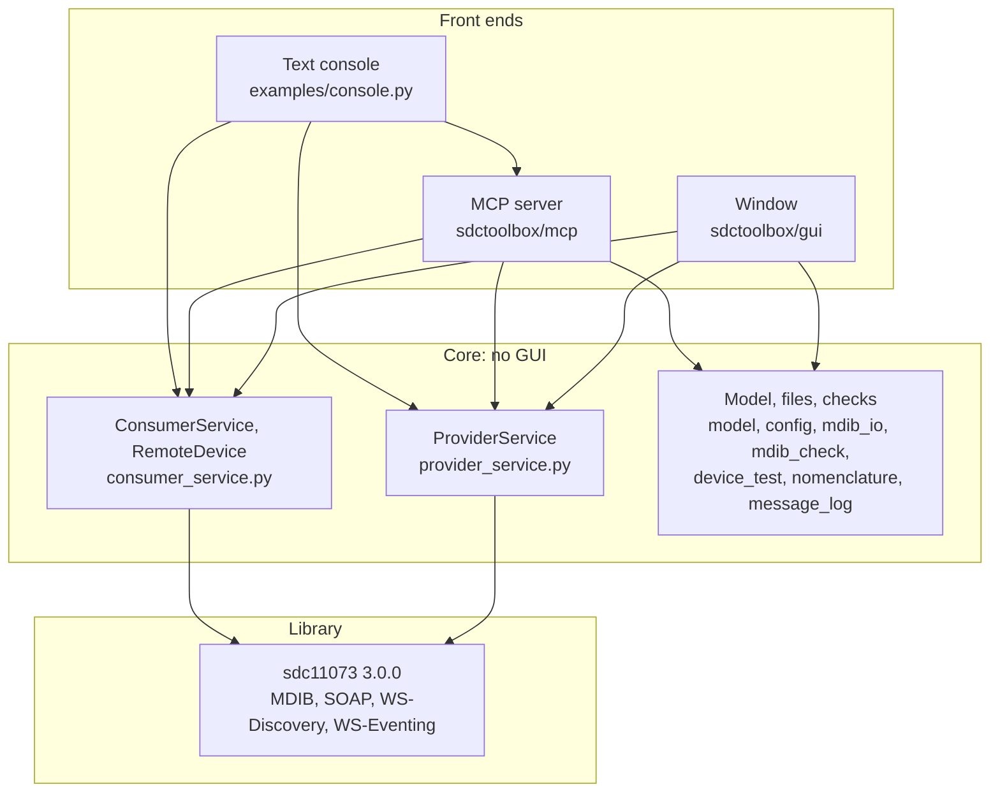
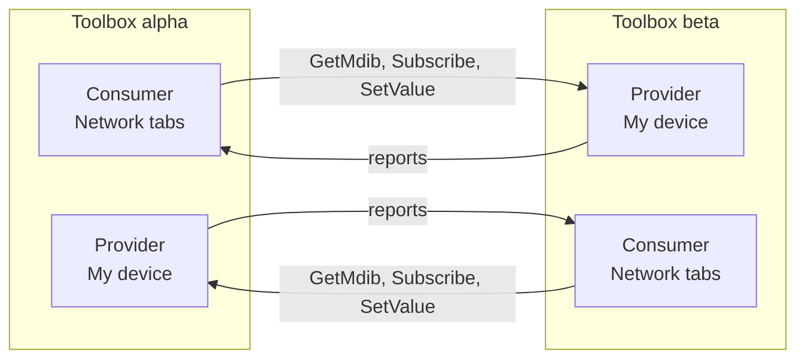
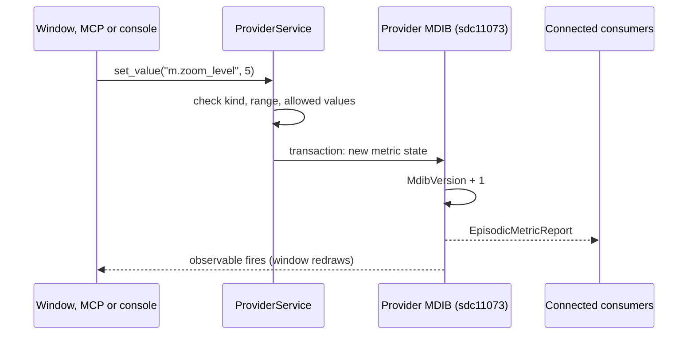

# Architecture
{: .no_toc }

1. TOC
{:toc}

## The layers

The toolbox is a Python package, `sdctoolbox`, in three layers. The lower layers never import the
upper ones, so the services work the same under the window, the console, the MCP server and a test.

| Part | Files | Job |
|---|---|---|
| Entry point | `run_toolbox.py` | reads the command line or the start dialog, builds the provider, opens the window or the headless MCP server |
| Provider | `provider_service.py`, `handlers.py`, `sample_generation.py`, `native_mdib.py`, `sdc11073_v3_adapter.py` | publishes My device and keeps its MDIB consistent; see [The provider](provider.md) |
| Consumer | `consumer_service.py`, `message_log.py` | finds and connects to other devices, reads foreign MDIBs safely; see [The consumer](consumer.md) |
| Model | `model.py` | what a data source, alarm, action, patient and location are, before they become BICEPS |
| Files | `config.py`, `mdib_io.py` | reading and writing MDIB files and old JSON profiles, with toolbox behaviour |
| Checks | `mdib_check.py`, `mdib_explain.py`, `device_test.py` | the MDIB check, the tree's explanations and the Device test |
| Codes | `nomenclature.py` | the shipped MDC codes and loaded code files |
| Network | `ports.py`, `network.py`, `security.py`, `http_server.py` | port range, address parsing, TLS policy, the HTTP boundary |
| Window | `gui/` | the PySide6 interface; see [The window](gui.md) |
| Agents | `mcp/` | the MCP server, its tools and the GUI guide; see [MCP](../automation/mcp.md) |
| Settings | `constants.py` | every handle prefix, coding system, port and default in one place |

## One instance, two roles

Every toolbox is a provider and a consumer at once. The provider publishes My device; the consumer
side has one connection per Network tab. Start the toolbox twice and each can see the other.

## What happens when you change a value

The same path serves a slider in the window, a remote write from another device and an MCP call:

A write from another device arrives as a SOAP request. The provider's operation handler checks it
(enabled, in the allowed range, no simulated refusal) and either applies it through the same path
or refuses it with an error code and a reason the consumer sees.

## Design rules

- **Nothing invented, nothing hidden.** The consumer shows what a device sends, including what it
  does not understand. A loaded MDIB is published as it is, not corrected.
- **The device decides.** Every write goes through an operation the provider can refuse, and the
  consumer shows the device's own answer.
- **Decimals, never floats.** Values are `Decimal` end to end, as BICEPS defines them.
- **No GUI thread in the core.** The library calls back on its own threads; the window moves every
  callback to its own thread before touching a widget (see [The window](gui.md)).
- **One place for constants.** No handle, coding system or port is written outside `constants.py`.
