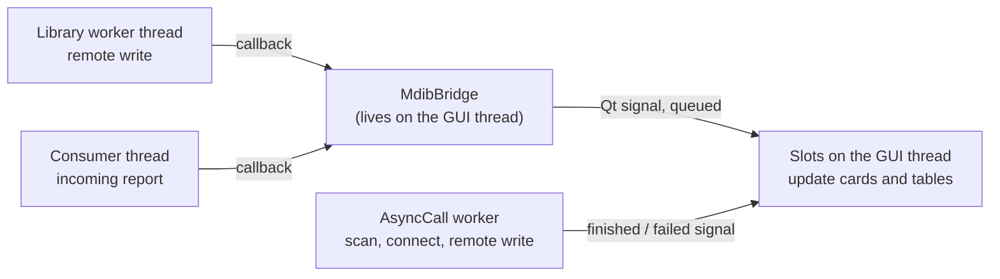

# The window
{: .no_toc }

The interface (`sdctoolbox/gui`) is PySide6. It is a skin over the services: everything it does,
the console and the MCP tools can do too.

1. TOC
{:toc}

## Threads

The SDC library calls back on whichever thread caused a change. A value set from the window
arrives on the GUI thread, but a value a remote consumer sets arrives on the library's worker
thread, and a report from another device on the consumer's thread. Qt widgets may only be touched
from the GUI thread.

- `qt_bridge.MdibBridge` turns every library callback into a Qt signal. Because the bridge is
  created on the GUI thread, Qt queues signals from other threads and delivers them there.
- `async_call.AsyncCall` runs slow work (scanning, connecting, a remote write) on worker threads
  and reports the result back the same way, so the window never freezes. Each piece of work has a
  key, so a result that arrives after its tab was closed or reused is ignored.
- The MCP server answers each request on its own thread. `mcp_bridge` hands anything that touches
  My device or a widget to the GUI thread and waits for it, so an agent's change takes the same
  path as a click.

## The main parts

| File | Part |
|---|---|
| `main_window.py` | the window, the two tabs or split view, menus, status bar, Advanced mode |
| `provider_pane.py` | the My device tab |
| `consumer_tabs.py`, `consumer_pane.py` | the Network tab: discovery and one pane per connection |
| `messages_view.py` | the Messages section |
| `mdib_check_window.py`, `device_test_window.py`, `activity_log.py` | the windows beside the main one |
| `new_metric_dialog.py`, `edit_dialogs.py`, `new_alert_dialog.py`, `new_action_dialog.py`, `context_dialog.py`, `code_picker.py`, `startup_dialog.py` | the dialogs |
| `collapsible.py` | the foldable sections and their chips |
| `styling.py` | light and dark colours, taken from the live palette |

## Cards

`gui/widgets` holds the metric cards. Both sides describe a metric differently (`MetricSpec` for My
device, `RemoteMetric` for a connection), so both are turned into a `WidgetSpec` and the controls
only ever see that.

`factory.py` holds the list of controls. Each control says which metrics it can show; the factory
asks them in order and the first that fits wins. **Adding a kind of control** is one class in
`controls.py` and one line in `factory.py`; nothing else names a control.

The plot (`plot.py`) is painted by hand: a polyline and a few guide lines. A charting library would
have been the largest dependency of the project for a widget of about a hundred lines.

## Design file

`design/GUI.figcraft` holds the design of every window, dialog and popup in light and dark mode.
GUI changes are drafted there first. The screenshots in this documentation are taken from the real
application by `helpers/docs_screenshots.py`.
