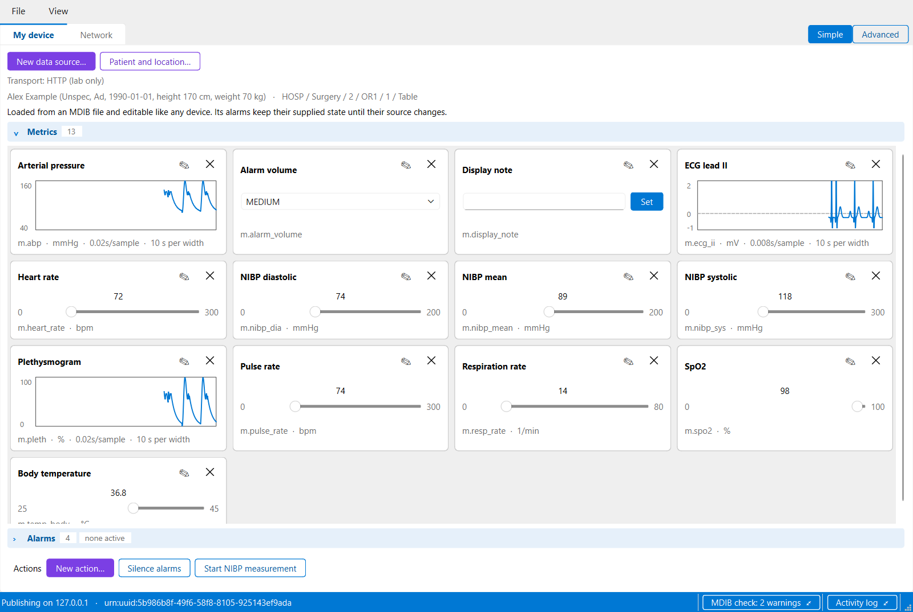

# SDC Testing Toolbox

A desktop tool for learning and testing **IEEE 11073 SDC**, the standard that lets medical
devices find each other on a network, describe themselves, share live data and control each
other.

With the toolbox you can:

- **build a device** in a few clicks: numbers, texts, choices, waveforms, alarms and actions,
  published on the network as a real SDC provider;
- **connect to any SDC device**, see its data live, change its values and run its actions;
- **check a device**: the MDIB check says where a device description differs from what the
  standards ask, and the Device test asks a running device the questions a consumer would;
- **test your own consumer** with simulated faults: invalid values, a sensor in standby, a
  device that answers slowly, refuses writes or vanishes without saying goodbye;
- **look under the hood**: the containment tree of every device, and every SOAP message that
  went over the wire;
- **let an AI agent drive it** over MCP, or script it from a text console or from Python.

[Get started](getting-started/){: .btn .btn-primary .mr-2 }
[Download a release](https://github.com/DMeurer/SDC-Testing-Toolbox/releases){: .btn .mr-2 }
[View it on GitHub](https://github.com/DMeurer/SDC-Testing-Toolbox){: .btn }

{: .warning }
This is a learning and testing tool, **not a medical device**. Its SDC library,
[sdc11073](https://github.com/Draegerwerk/sdc11073), is by its own notice not intended for
clinical trials, clinical studies or clinical routine use.

## Where to start

| If you want to … | Read |
|---|---|
| install the toolbox and see two devices talk | [Installation](getting-started/install.md), then [Your first device](getting-started/first-steps.md) |
| understand what SDC is about first | [SDC in ten minutes](getting-started/sdc-basics.md) |
| find out what a button or column does | the [User guide](user-guide/) |
| check a device you are building | [MDIB check](user-guide/mdib-check.md) and [Device test](user-guide/device-test.md) |
| test the consumer you are building | [Advanced mode and faults](user-guide/advanced-mode.md) |
| drive the toolbox from an agent, a script or a terminal | [Automation](automation/) |
| know how the toolbox is built | [How it works](how-it-works/) |

## Built on

- [sdc11073](https://github.com/Draegerwerk/sdc11073) 3.0.0, the Python SDC implementation by
  Drägerwerk, for discovery, the MDIB and the SDC services;
- [PySide6](https://doc.qt.io/qtforpython-6/) (Qt for Python) for the window;
- Python 3.12.

The toolbox is free software under the
[GNU General Public License version 3 only](https://github.com/DMeurer/SDC-Testing-Toolbox/blob/main/LICENSE).
Its dependencies keep their own licenses; see
[Third-Party Notices](https://github.com/DMeurer/SDC-Testing-Toolbox/blob/main/THIRD_PARTY_NOTICES.md).
