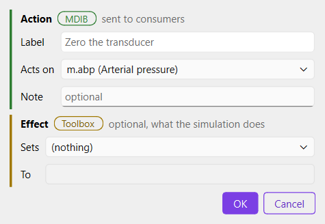

# Actions

Not everything a device does is a value you write. *Home the axes*, *give a bolus*, *white balance
now*: there is nothing to type and nothing to read back, only something to start. SDC models this
with an **ActivateOperation**, a different kind of operation from the set operation behind a
writable metric.

Actions appear as a row of buttons at the bottom of My device and of every Network connection.
Pressing a Network button asks the other device to run the action; the button is enabled only while
the device says the operation is enabled.

## Creating an action

On My device, press **New action…**:



- **Label**: the button's text.
- **Acts on**: the part of the device it acts on: the device, a unit (VMD) or a channel.
- **Note**: an optional explanation.
- **Sets** and **To**: one metric and the value it gets when the action runs, such as `m.mode`
  to `IDLE`.

The dialog sets one value. An action can set several: the presets do, and the
[console, MCP and Python](../automation/) take a list of values.

An action in the toolbox sets values when it runs, which stands in for the machinery a real device
would have. It is meant to be visible: an action whose result cannot be seen cannot be checked, and
here the result is exactly the values it moved. Load the surgical microscope preset, connect to it
from a second toolbox and run *Home axes*: six numbers change at once without any of them having
been sent.

## What is stored

What an action sets has no place in SDC, so the toolbox stores it as
[toolbox behaviour](presets-and-files.md#toolbox-behaviour) on the operation:

```xml
<dom:Operation Handle="act.home_axes" xsi:type="dom:ActivateOperationDescriptor" OperationTarget="vmd.motion">
  <ext:Extension>
    <tb:Action ext:MustUnderstand="false">
      <tb:Effect Target="m.axis_x" Value="0"/>
      <tb:Effect Target="m.axis_z" Value="300"/>
      <tb:Effect Target="m.motion_mode" Value="LOCKED"/>
    </tb:Action>
  </ext:Extension>
</dom:Operation>
```

An activate operation in a file without this behaviour is published, but it refuses to run.

{: .note }
The toolbox's consumer runs actions that take no arguments. An activate operation that needs
arguments is shown but cannot be run from the toolbox.
