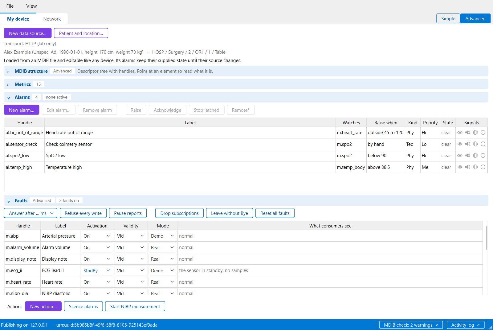
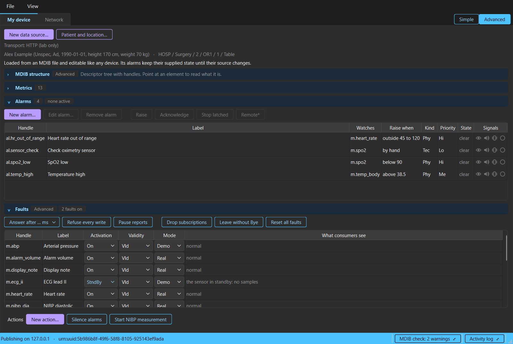

# Advanced mode and faults
{: .no_toc }

1. TOC
{:toc}

The toolbox starts in **Simple** mode, for learning SDC. **Advanced** mode is for people testing
their own SDC consumer, and for looking under the hood. Switch it with *View > Advanced mode* or the
**Simple | Advanced** switch at the right of the tab strip. The choice is remembered.

Advanced mode hides nothing that Simple mode shows. It adds:

| Where | What |
|---|---|
| My device | the **Faults** section under Alarms, a chip on each card whose metric has a fault, and the **MDIB structure** of a device loaded from an MDIB file |
| Every Network connection | the **MDIB structure** and the **[Messages](network.md#messages)** sections |

Sections that belong to Advanced mode carry an *Advanced* chip.

{: .only-light }
{: .only-dark }

## Faults

States that go wrong on purpose, so you can see how a consumer copes. The mode is a view setting
only: faults set over MCP or the console work in either mode and stay on when you switch back to
Simple.

### Device-wide faults

Buttons; a tinted button is on. They are runtime only and never saved.

| Button | What the device does | Limits |
|---|---|---|
| Answer after … ms | waits 250 to 5000 ms before answering Set, Activate, GetMdib, GetMdState and GetMdDescription. Tests timeouts. | other requests (contexts, metadata, eventing) answer at once |
| Refuse every write | answers every remote set and activate with `Fail`, error `Oth`, and a reason saying it is simulated | local edits and actions run from the window still work |
| Pause reports | sends no state reports and no waveforms. Switched off, every current state is reported once so consumers catch up. | description changes and operation reports still go out |
| Drop subscriptions | forgets every subscription at once without a SubscriptionEnd; the consumer finds out when its Renew fails | |
| Leave without Bye | vanishes like a crashed device: no Bye, no answer to Probe or Resolve, every request dropped unanswered, subscriptions forgotten. Switched off, it comes back with a Hello and consumers must connect again. | the listening port stays open, and the MDIB keeps its sequence |
| Reset all faults | ends every fault, device-wide and per metric | |

### Faults per metric

The table sets, for each metric, the values a consumer reads from its state, and says in plain
words what a consumer sees. A value that differs from normal is shown in the accent colour.

| Column | SDC value | Values |
|---|---|---|
| Activation | `ActivationState` | *On* normal; *StndBy* standby, *NotRdy* not ready, *Fail* failed, *Shtdn* shutting down: a consumer should show no value, and generated waveforms stop. *Off* is the ordinary switch. |
| Validity | `MetricQuality/@Validity` | *Vld* valid, *Vldated* validated by a clinician, *Ong* measurement going on, *Qst* questionable, *Calib* taken while calibrating, *Inv* invalid, *Oflw* / *Uflw* above / below the measuring range, *NA* not available |
| Mode | `MetricQuality/@Mode` | *Real* from a real measurement, *Test* test data, *Demo* demo data (normal for generated waveforms) |

These are real MDIB state. They stay on every later value, whether you set it, a consumer writes
it, an action sets it or the generator makes it, and they are saved in MDIB exports and come back
when the file is loaded.

## What is not simulated

There are no lifecycle sequences: a metric does not go from *NotRdy* to *On* by itself, and the
MDS, VMDs and channels have no fault controls. Set degraded states by hand, over MCP or from the
console.

The same faults are available as the MCP tools `get_faults`, `set_metric_fault`,
`set_device_faults` and `reset_faults`, and as the console commands `fault` and `faults`.
