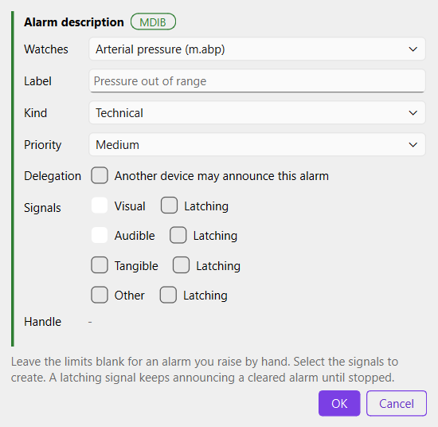

# Alarms
{: .no_toc }

1. TOC
{:toc}

## Conditions and signals

SDC keeps two things apart:

| | |
|---|---|
| **condition** | the fact, such as "the pressure is too high". It has a kind and a priority, and it is present or not. |
| **signal** | how the fact is announced: visibly, audibly, by vibration or otherwise. |

One condition can drive several signals, which is why they are separate parts of the MDIB rather
than flags on one. The toolbox gives a new alarm a visual and an audible signal by default.

## Creating an alarm

Open the **Alarms** section on My device and press **New alarm…**:

- **Watches**: the metric the alarm is about.
- **Label**, **Kind** (*Phy* physiological, *Tec* technical, *Oth* other) and **Priority** (*Lo*,
  *Me*, *Hi*).
- **Limits** (numbers only): with a lower or upper limit the alarm follows its metric by itself and
  becomes a *limit alert condition*. Without limits it only changes when you raise or clear it by
  hand.
- **Signals**: which manifestations it has (visible, audible, tangible, other) and whether they
  latch.
- **Delegation**: whether another device may take over announcing the signals.

## The alarm table

| Column | Shows |
|---|---|
| Handle, Label | the alarm |
| Watches | the source metric |
| Raise when | the limits, or *by hand* |
| Kind, Priority | as above |
| State | *active* (in red) or *clear* |
| Signals | one icon per signal |

The **signal icons** are, in this order: an **eye** (visible), a **speaker** (audible), a **phone
with vibration marks** (tangible) and a **circle** (other). An icon is **red** while its signal
announces the condition, and **grey** when it is off or acknowledged. Point at the column to read
each signal's presence: *Ack* means acknowledged, *→Rem* that it is announced remotely.

A connection on the Network tab has the same table, read from the other device, with its
*Limits*.

## The buttons

| Button | Does |
|---|---|
| New alarm…, Edit alarm…, Remove alarm | create one, change its limits and priority, remove it with its signals |
| Raise / Clear | set an alarm without limits by hand. An alarm with limits follows its metric; change the value instead. |
| Acknowledge | sets each signal's presence from *On* to *Ack* |
| Stop latched | sets each latching signal that still announces a cleared condition from *Latch* to *Off* |
| Remote\* / Local\* | moves delegable signals between here (*Loc*) and a remote location (*Rem*) |

### Acknowledging does not clear an alarm

This is the part of the split that matters. Acknowledging changes the **signals**, not the
**condition**: the State stays *active* and the icons go grey. Push the value further out of range
and the acknowledgement stays, because the fact has not changed. Bring it back into range and out
again, and it does not, because that is a new occurrence.

### Delegation

Delegation records that another device announces a signal instead. SDC only allows it where the
signal was created with **Delegation** ticked; the toolbox enforces that. The asterisk on
*Remote\** is a reminder that it only demonstrates the *Loc*/*Rem* state: it does not hand the
signal over to a real second device.

## Limits

- Limits are offered for numbers only. Without limits an alarm is a plain alert condition that
  moves only by hand.
- A value written by a consumer moves an alarm exactly as a local edit does.
- An alarm loaded from an MDIB file keeps the state the file gave it until its source metric
  changes.
