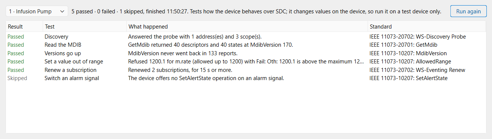
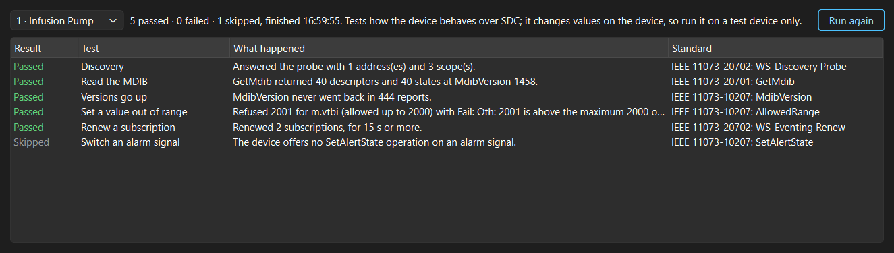

# Device test

The [MDIB check](mdib-check.md) reads a description. The Device test asks a **running** device a few
questions the way a consumer would, and says in plain words what happened and which standard the
question comes from. It is meant for someone building their first SDC device.

{: .only-light }
{: .only-dark }

## Running it

Connect to the device on the Network tab and press **Test this device…** at the right of its status
lines. The window opens beside the main window and the test starts. The box at the top picks the
connection; **Run again** repeats the test.

## The tests

| Test | Passes when | Standard |
|---|---|---|
| Discovery | the device answers a WS-Discovery probe with its addresses and scopes | IEEE 11073-20702 |
| Read the MDIB | GetMdib returns descriptors and an MdibVersion | IEEE 11073-20701 |
| Versions go up | the MdibVersion of each kind of report never goes back | IEEE 11073-10207 |
| Set a value out of range | the device refuses a value above a settable number's maximum | IEEE 11073-10207 |
| Renew a subscription | the device grants a renewal for every subscription it granted | IEEE 11073-20702 |
| Switch an alarm signal | the device accepts SetAlertState with a signal's current state | IEEE 11073-10207 |

Each row is **Passed**, **Failed** (in bold) or **Skipped**. A test the device gives no chance for,
such as a device without a settable number with a range, or without an alert-state operation, is
skipped.

{: .warning }
The test changes values on the device. If a device accepts the out-of-range value, the test puts
the old value back, but run it on a test device only.

## What it is not

This is not a conformance test. A pass only means the device answered these few questions the way
the standards expect. To see how a consumer copes with a device that misbehaves, turn the tables:
use the toolbox as the device and [simulate faults](advanced-mode.md).

The console's `test` command and the MCP tool `test_device` run the same test.
