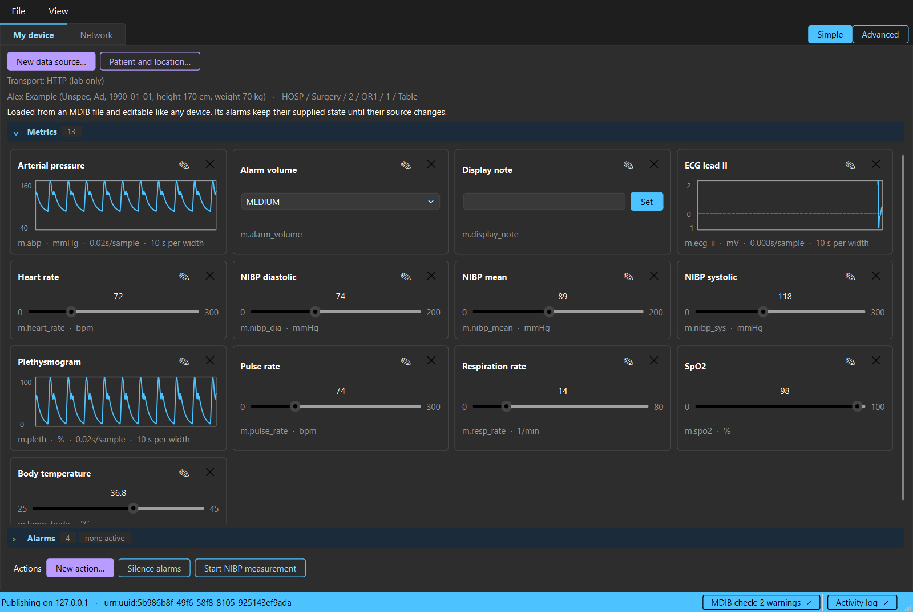

# User guide

Everything the window can do, part by part. The pages follow the window: first the window
itself, then **My device** (the device you publish), then **Network** (everybody else's), then the
tools that check devices, and finally files and security.

