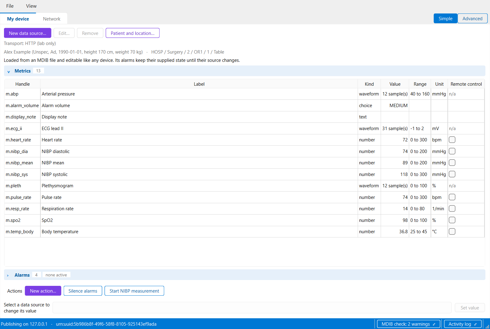
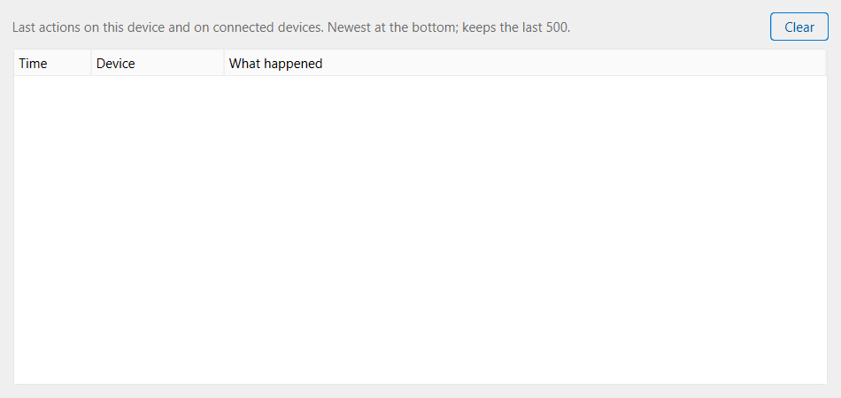

# The main window
{: .no_toc }

1. TOC
{:toc}

## Two tabs, two roles

- **My device** is the SDC device this toolbox publishes. You build and change it here.
- **Network** is every other SDC device. You find, connect to and control them here.

*View > Split view* (**F8**) shows both side by side with a movable divider instead, which is the
best way to watch one react to the other. **F8** again stacks them as tabs.

At the right of the tab strip, **Simple | Advanced** switches [Advanced mode](advanced-mode.md),
which adds the tools for testing consumers and for looking under the hood.

## Sections

Both tabs are made of sections: *Metrics*, *Alarms*, *Faults*, *MDIB structure*, *Messages*. Click
a heading to fold or unfold it. The small **chips** in a heading say how many items it has, how
many alarms are active, how many faults are on, or that the section belongs to Advanced mode.

## Cards or tables

*View > Use widgets if possible* (**F9**) chooses how metrics are shown:

- **Cards** (the default): one card per metric with a control that fits it: a slider, a stepper,
  a dropdown, a text field or a plot. See [Cards](my-device.md#cards).
- **Tables**: one row per metric with its handle, label, kind, value, range, unit and whether it
  can be written. Tables show every detail at once.

## The status bar

The bar at the bottom says *Publishing on 127.0.0.1* and the EPR of My device, its identity on the
network. At its right:

- **MDIB check: …** shows the live result of the [MDIB check](mdib-check.md) for My device:
  *2 errors*, else the number of warnings, else *OK*. Click it to open the check.
- **Activity log** opens a window that lists what happened: values other devices changed,
  actions they ran, alarms raised, acknowledged and cleared, and connected devices changing their
  structure, on My device and on every connection.

Values that change by themselves, such as a running waveform, are left out of the activity log on
purpose; they would bury everything else.

## Menus

**File**

| Item | Shortcut | Does |
|---|---|---|
| Import config… | Ctrl+O | replaces My device with an MDIB file (or an older JSON profile). This restarts the device, so connected consumers must connect again. |
| Export config… | Ctrl+S | saves My device as an MDIB file, with or without [toolbox behaviour](presets-and-files.md#toolbox-behaviour) |
| Check MDIB… | Ctrl+K | opens the [MDIB check](mdib-check.md) |
| Load preset | | replaces My device with one of the [shipped devices](presets-and-files.md#the-shipped-presets) |
| Exit | Ctrl+Q | |

**View**

| Item | Shortcut | Does |
|---|---|---|
| Always show menu bar | | unticked, the menu bar hides until you press **Alt** |
| Use widgets if possible | F9 | cards instead of tables |
| Split view | F8 | both tabs side by side |
| Fullscreen | F11 | |
| Dark mode | | dark colours |
| Advanced mode | | the same as the *Simple / Advanced* switch |

Advanced mode is remembered for the next start. The other view settings start from their
defaults each time; `--theme` and `--fullscreen` set the colours and fullscreen at startup (see
[Command line](../reference/command-line.md)).
