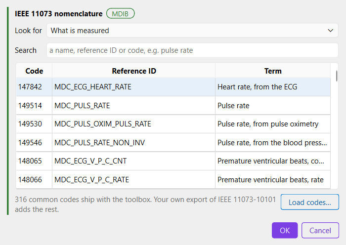

# Picking MDC codes
{: .no_toc }

1. TOC
{:toc}

## Why codes

A label is not meaning. A unit written only as "mmHg" publishes a number with a comment attached,
and another device can do nothing with it. SDC says what a metric is and in which unit with
**codes** from the IEEE 11073-10101 nomenclature, *MDC* for short: `MDC_PULS_RATE` (149514) is a
pulse rate, `MDC_DIM_MMHG` (266016) is millimetres of mercury, whatever the label says.

The codes the toolbox writes are context-free numeric codes in the coding system
`urn:oid:1.3.111.2.11073.10101.3`. Things the nomenclature has no term for get a code in the
toolbox's private coding system, `urn:sdc-testing-toolbox:private`, which is honest: inventing
codes that look official would be worse.

## Pick an MDC code

*New data source* has a **Measures** row and a **Unit** row, each with a **Pick…** button:



- **Look for**: what is measured, units, alarm codes or everything.
- **Search**: type a name, a reference ID or a code, such as `pulse rate`, `MDC_DIM_MMHG` or
  `149514`. The best matches come first.
- **Only units for …**: when you pick a unit after a measure, only that measure's usual units are
  offered, for example bpm, pulses/min and 1/min for a pulse rate. Untick it to see every unit.
- Double-click a term to pick it. The field then shows it as
  `Pulse rate · MDC_PULS_RATE (149514)`.

## Where the codes come from

The toolbox ships about 300 common terms: every code the presets use and the usual vital signs,
blood pressure, temperature, ventilation, gas, infusion, alarm and unit codes. Each code was
checked against IEEE 11073-10101:2020 and its amendments. The short names are written in the
toolbox's own words, because the standard's descriptions are copyrighted. The units offered per
measure were checked against [NIST RTMMS](https://rtmms.nist.gov).

### Loading more codes

**Load codes…** adds the rest of the nomenclature from a file of your own. The file is remembered
and loads again next time; a file that cannot be used is reported and ignored.

- **From your copy of the standard**: `helpers/Coding Systems/export_11073_tables.py` exports the
  tables of your licensed copy as `codes.csv`. Keep it to yourself; never commit or share it.
- **From NIST RTMMS**: with a free account, download the base term file under *Download Term
  Files* and convert it:

  ```powershell
  .venv\Scripts\python.exe "helpers\Coding Systems\rtmms_to_codes_csv.py" rtmms_base_terms.xlsx
  ```

  The resulting `rtmms.csv` adds RTMMS's terms to the search and its units to *Only units for …*.

## How much of a device has a code

The presets show how far the nomenclature reaches. A patient monitor is almost entirely
expressible in standard codes; a surgical microscope is not:

```
ventilator              24 mdc,   0 private  (100% standard)
patient-monitor         25 mdc,   1 private  (96% standard)
infusion-pump           15 mdc,   1 private  (94% standard)
insufflator             10 mdc,   9 private  (53% standard)
hf-generator            11 mdc,  10 private  (52% standard)
surgical-microscope     15 mdc,  20 private  (43% standard)
endoscopic-camera        9 mdc,  15 private  (38% standard)
```

For the surgical devices, the parts with standard terms are mostly the *units* (mm, degrees,
watts); what the device actually does has no agreed term yet.

Over MCP, `search_codes` runs the same search; see [MCP](../automation/mcp.md).
