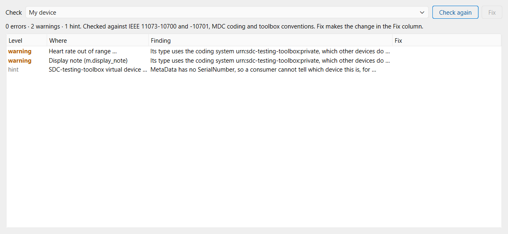
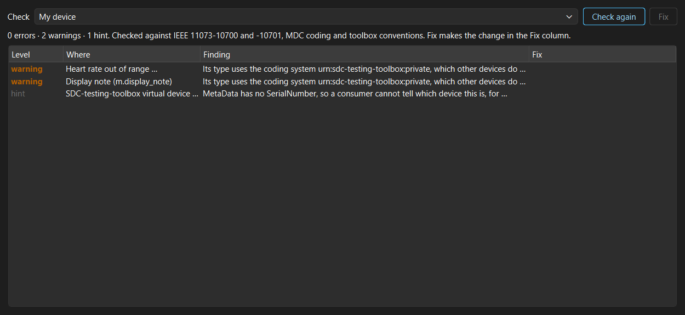

# MDIB check
{: .no_toc }

1. TOC
{:toc}

An MDIB the XML schema accepts can still leave a consumer guessing: a metric with no code, a value
with no time stamp, a setting with no allowed range, an alarm nobody hears. The MDIB check lists
these and says for each what is wrong and what a consumer loses by it.

{: .only-light }
{: .only-dark }

## Opening it

- *File > Check MDIB…* (**Ctrl+K**), or
- the **MDIB check** button in the status bar, which always shows My device's current result:
  *MDIB check: 2 errors*, else the number of warnings, else *OK*. Hints alone count as OK.

The window opens beside the main window.

## The window

- **Check**: *My device*, or an open connection by its tab name. My device is checked again by
  itself after every change; a connection only when you press **Check again**.
- **Summary**: *0 errors · 2 warnings · 1 hint*, and what was checked against.
- **Level**, **Where** (the label and handle), **Finding** (what is wrong, why it matters, and the
  rule in brackets, such as *10701 TR0204*), and **Fix**.
- **Double-click** a finding to show its element: its card or table row, its alarm, or its entry in
  the MDIB structure tree. For a connection, its tab comes to the front.

| Level | Meaning |
|---|---|
| **error** | breaks a "shall" requirement, or points at an element that does not exist |
| **warning** | breaks a "should" requirement or an MDC coding rule |
| **hint** | a toolbox convention: not required, but leaving it out costs a consumer something |

## Fixing findings

Some findings on My device can be fixed for you. The **Fix** column says what would change, and
**Fix** makes that change for the selected finding:

- a private or non-numeric code becomes the MDC code its description names outright, such as
  *Use MDC_PULS_RATE* for a metric described as "Pulse rate". A term measured in other units than the metric's MDC
  unit is not offered. A near match stays a "perhaps" in the
  finding, for you to decide;
- an outdated or missing MDC coding system becomes `urn:oid:1.3.111.2.11073.10101.3`;
- a high-priority alarm without an audible signal gets one.

A connection's MDIB belongs to the other device, so it has no Fix column.

## What is checked

The rule ID is shown next to each finding.

- **IEEE 11073-10700** (SDC base provider): coded values (TR1814, TR1840, TR1842 name the current
  nomenclature as `urn:oid:1.3.111.2.11073.10101.3` or later; TR1358 private codes need a
  translation), the language of descriptions (TR0277), MetaData (TR0251), the clock's safety class
  (TR1590), connector numbers for look-alike metrics (TR1438) and context association bookkeeping
  (TR1304, TR1636 to TR1639, TR1959).
- **IEEE 11073-10701** (SDC metric provider): values, time stamps and validity (TR0674, TR0675,
  TR0214, TR0216, TR0187, TR0128), availability and determination period (TR0204, TR0136), demo
  values (TR0199), technical ranges (TR0239), unique allowed values (TR0487), life time and delay of
  medical metrics (TR0210, TR0682) and switched-off channels (TR1075).
- **MDC coding**: a type on every metric, alarm and operation; MDC codes rather than private coding
  systems where IEEE 11073-10101 has a term (BICEPS R0008); numeric MDC codes.
- **Toolbox conventions** (hints): a resolution on numbers, an allowed range on set operations, a
  serial number, an audible signal on high-priority alarms, an alert signal on every alarm.

## Limits of the check

Only what one snapshot of the MDIB shows is checked, never behaviour over time; for that, see the
[Device test](device-test.md). The alert (-10702) and remote-control (-10703) participant key
purposes are not covered yet. The shipped presets pass without errors; their warnings are mostly
private codes for things the nomenclature has no term for.

Agents get the same list from the MCP tool `check_mdib` and make the offered fixes with
`fix_mdib`; the console has `check` and `fix`. See [Automation](../automation/).
