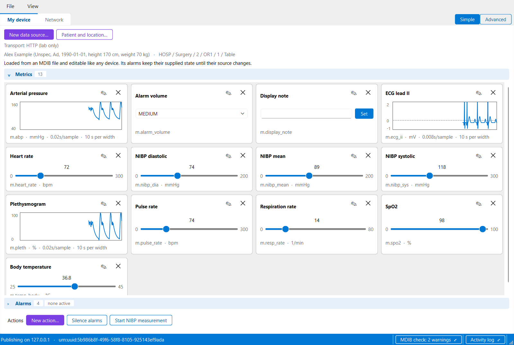
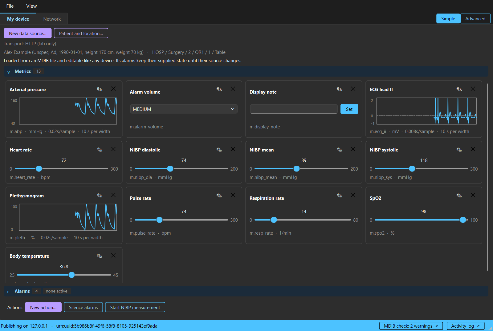
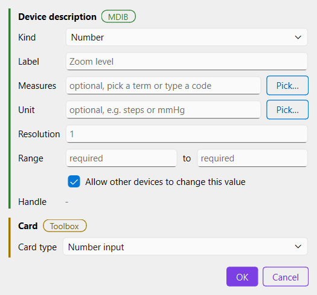
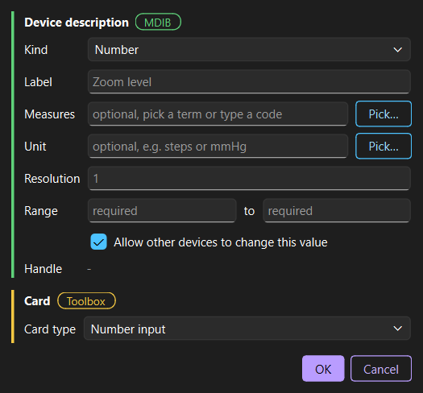
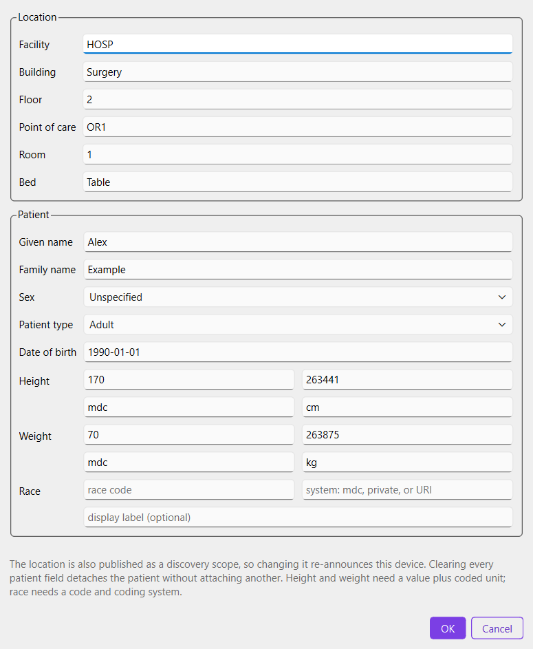
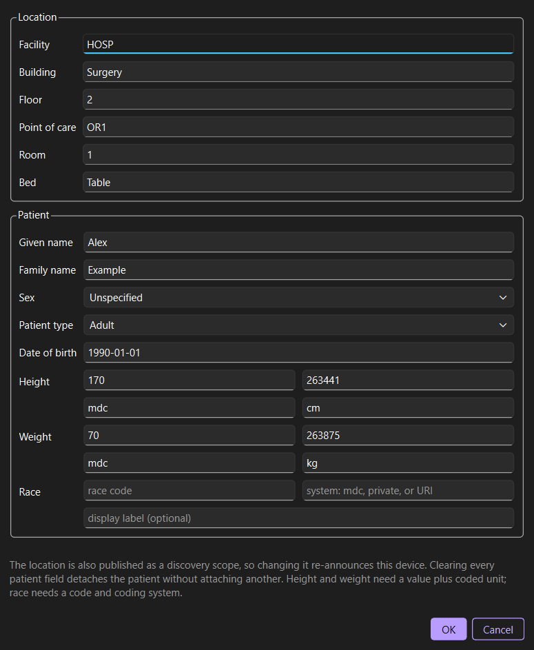

# My device
{: .no_toc }

The device this toolbox publishes. Every other SDC consumer on the network, including a second
toolbox, sees exactly what this tab shows.

1. TOC
{:toc}

{: .only-light }
{: .only-dark }

## What the tab shows

From the top:

- **New data source…** and **Patient and location…**.
- **Transport**: *HTTP (lab only)*, or HTTPS when the toolbox runs with [TLS](security.md).
- The patient and the location the device publishes right now.
- For a device loaded from an MDIB file, a note that it is edited like any other device.
- **MDIB structure** ([Advanced mode](advanced-mode.md), devices loaded from an MDIB file): the
  device's description as a tree.
- **Metrics**: one card or table row per data source.
- **Alarms**: the alarm table and its buttons; see [Alarms](alarms.md).
- **Faults** (Advanced mode): simulated faults; see [Advanced mode](advanced-mode.md).
- **Actions**: *New action…* and one button per action; see [Actions](actions.md).

## Data sources

A *data source* is one metric of the device. **New data source…** creates one:

{: .only-light }
{: .only-dark }

The dialog is split in two parts, marked by their chips: **MDIB** is what goes into the device's
description and every consumer sees; **Toolbox** is how this toolbox shows it.

| Field | For | Meaning |
|---|---|---|
| Kind | all | Number, Text, Choice, Waveform or Distribution (see [SDC in ten minutes](../getting-started/sdc-basics.md#metrics-the-values)) |
| Label | all | the name people read; the handle is made from it, such as `m.zoom_level` |
| Measures | all | what the metric is, as an MDC code. *Pick…* opens [Pick an MDC code](mdc-codes.md). Left empty, the toolbox makes a private code from the label. |
| Unit | numbers, waveforms, distributions | the unit; *Pick…* finds its MDC code. A unit typed by hand stays a plain label. |
| Resolution | numbers | how finely the value is measured; `1` for whole numbers |
| Range | numbers | lowest and highest value the device can produce. **Required** for numbers (IEEE 11073-10701 TR0239). Waveforms and distributions take the range of the generated samples when left empty. |
| Allowed values | choices | the values a choice can take |
| Sample period, Shape | waveforms | how often a sample is taken, and the curve the generator draws; see [Waveforms](waveforms.md) |
| Domain | distributions | what the samples are spread over, such as 0 to 500 Hz |
| Section | all | the channel it goes into |
| Allow other devices to change this value | numbers, texts, choices | adds a set operation, so consumers may write it |
| Card type | all | the control on its card |

Waveforms and distributions cannot be remote-controlled: SDC has no operation that takes a sample
array.

### Changing a data source

Values change from two directions, and both look the same: you edit them here, or a consumer
writes them over the network.

- On a **card**, use its control: drag the slider, press a step button, pick from the dropdown,
  type text and press *Set*.
- In the **table**, edit the *Value* cell and press **Set value**.

The **pencil** on a card (or **Edit…** under the table) opens *Edit data source*. It changes what
may change while the device runs: the allowed range or values for writes, remote control, the
waveform's curve, whether the metric is switched on, and the card. What the description says, such
as the kind or the unit, is shown but not editable, because changing it would make it a different
metric to every consumer.

The **X** on a card (or **Remove**) removes the data source, together with its alarms and the
operation that writes it.

A greyed-out row or card is switched **off**: no generated samples, no remote writes and no
alarms.

## Cards

Each card shows one metric:

- **Title**: the label. **Pencil**: edit the data source and its card. **X**: remove it.
- **The control**, chosen to fit the metric.
- **Footer**: the handle, the unit, and extras such as *read-only*, *samples*, the sample period
  (*0.02s/sample*), the time the plot shows (*10 s per width*) or a distribution's domain
  (*over 0 to 500 Hz*).

| Card type | Used for | Notes |
|---|---|---|
| Slider | a number with both ends of its range | *Update on* release sends when you let go, *change* while you drag. *Show ranges* labels both ends. |
| Number input | any number | the value with −10, −1, +1, +10 buttons; a number without both ends, or with more than 100 000 steps, gets this one |
| Dropdown | a choice | its allowed values |
| Text | a text | a field and a *Set* button; *split* shows the current and the wanted value, *multiline* allows several lines (Ctrl+Enter sends) |
| Plot | a waveform or a distribution | a moving trace or bars; *Legend* shows the axis values, *seconds per width* the time shown |
| Value only | any metric | just the value |

The cards reflow into as many columns as the window allows. Turning the mouse wheel over a card
scrolls the page; it never changes a value by accident.

## Patient and location

**Patient and location…** edits the two contexts the device publishes:

{: .only-light }
{: .only-dark }

- **Patient**: given and family name, sex, patient type, date of birth, height, weight and race.
  Height and weight need a value and a coded unit; race is a code, not free text. A new device
  starts with a made-up patient, *Alex Example*.
- **Location**: facility, building, floor, point of care, room and bed.

Setting a new patient does not overwrite the old one: the old state is *disassociated* and kept,
so the MDIB records who was attached when. Clearing every patient field detaches the patient.

Changing the location also changes how the device is found: it is part of the discovery scopes,
so the device announces itself again and a consumer filtering on the old location stops seeing it.

## Sections, VMDs and channels

A device built in the toolbox has one MDS, one VMD and one default channel. The **Section** of a
data source puts it into another channel, which is created when the first data source needs it. A
device loaded from an MDIB file keeps its own structure: a channel from the file is a section named
by its label, and new parts go into the file's own MDS, SCO and alert system.
