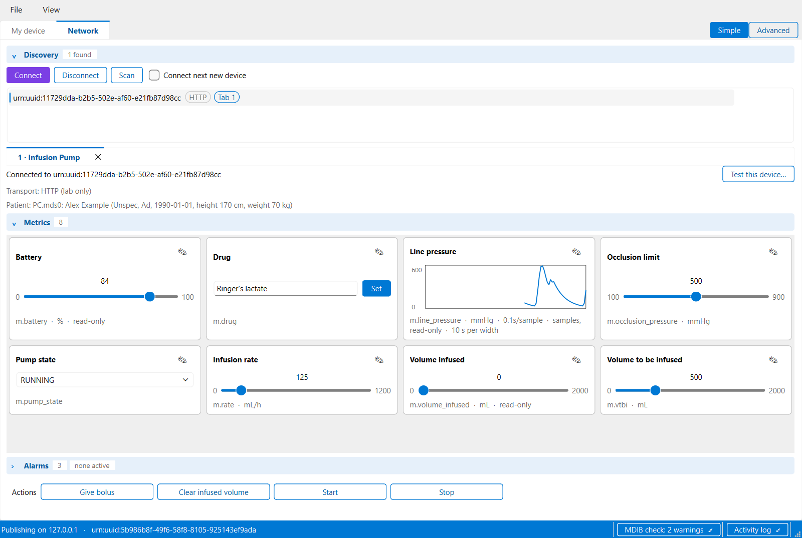
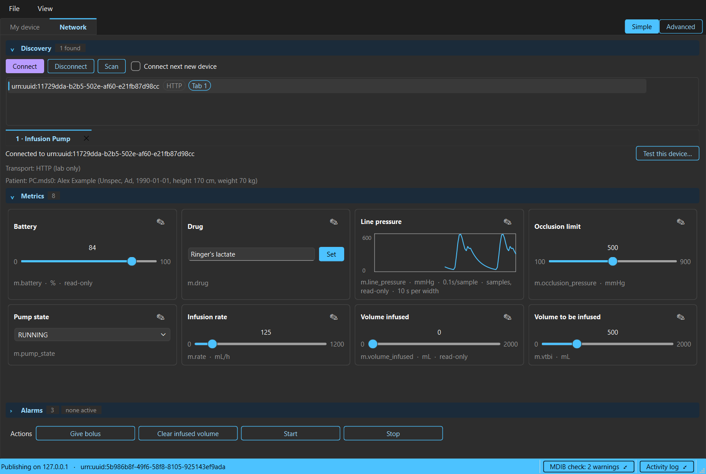
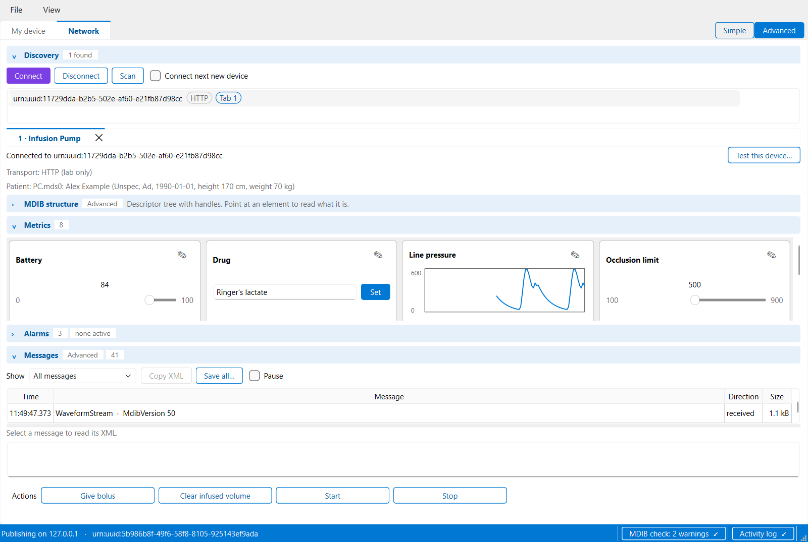
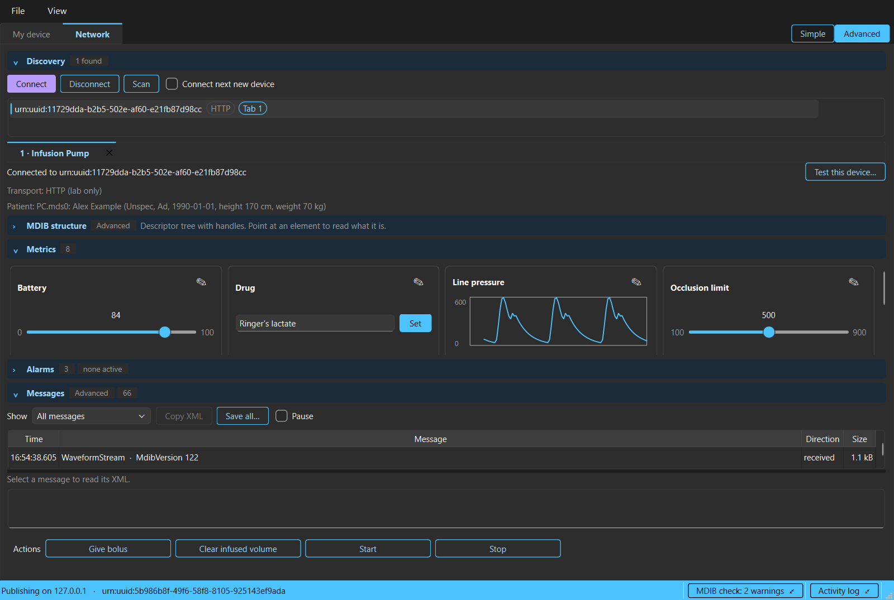

# Network
{: .no_toc }

The Network tab is a consumer: it finds other SDC devices, connects to them, shows their data live
and asks them to change things. It works with any SDC provider, not only with other toolboxes, and
shows what it does not understand instead of hiding it.

1. TOC
{:toc}

{: .only-light }
{: .only-dark }

## Discovery

The **Discovery** section at the top lists the devices found on the network:

| Control | Does |
|---|---|
| Scan | searches the network for SDC devices; the chip says how many were found |
| Connect | opens the selected device (or double-click it) |
| Disconnect | closes the connection of the current tab |
| Connect next new device | connects by itself to the next device that appears and was not seen before, then unticks. A known device restarting does not count. |

Each row shows the device's EPR, a chip for its transport (*HTTP* or *HTTPS*) and, once it is open,
a *Tab N* chip with its connection tab. Devices that announce themselves appear without a scan.
The toolbox's own device is not listed.

## Connection tabs

Each connected device gets its own tab, named like *1 · Infusion Pump*. Connecting to a device that
already has a tab brings that tab to the front instead.

- The tabs are independent: each has its own subscriptions, its own messages and its own
  failures. Switching tabs never pauses a connection.
- The tab's **X**, or **Ctrl+W** inside the Network tab, closes only that connection. Closing the
  last one leaves an empty tab ready to connect.
- Point at a tab to see its connection status.
- Connections are not saved and not reconnected after a restart.

## What a connection shows

- **Connected to** the device's EPR, its **Transport** and its **Patient**. Over TLS also the
  peer's certificate subject, issuer and SHA-256 fingerprint.
- **Test this device…** at the right of these lines opens the [Device test](device-test.md).
- **MDIB structure** ([Advanced mode](advanced-mode.md)): the device's containment tree with every
  handle, including parts the toolbox has no card for. Point at an entry to read what that kind of
  element is, what a consumer does with it and which rules apply.
- **Metrics**: cards or a table, like My device, but read from the device.
- **Alarms**: the device's alarms, their limits and their signals.
- **Messages** (Advanced mode): every SOAP message of this connection; see below.
- **Actions**: one button per action the device offers.

## Writing a value

A metric the device lets you write has a working control; the others say *read-only*. In table
mode, select a writable row, type the value in the editor below the table (a dropdown for a choice,
a field with the allowed range for a number) and press **Set on device**.

The device decides. The status bar shows the device's own answer: `Fin` when it is done, `FinMod`
when it did something slightly different, or `Fail` with the error code and the reason the device
gave, such as *500 is above the maximum 100*.

The table's **Range** column shows the range a write may use, or *technical:* the range the device
can produce; **Writable** says whether the device offers an enabled operation for it.

## Messages

In Advanced mode, the folded **Messages** section lists every SOAP message exchanged with this
device, newest last: each request, its response (or the SOAP Fault the device answers with), and
every report.

{: .only-light }
{: .only-dark }

| Column | Shows |
|---|---|
| Time | when it was sent or received |
| Message | its action and, where it has one, the MdibVersion, such as *WaveformStream · MdibVersion 44* |
| Direction | sent or received |
| Size | its size on the wire |

- Select a message to read its XML underneath. Drag the bar between the list and the XML to give
  either more room.
- **Show** filters the list: all messages, all without waveforms, requests and responses, or
  reports only.
- **Copy XML** copies the selected message; **Save all…** writes every kept message to a text file.
- **Pause** holds the list still while you read. When you scroll up, the list stays where you are
  while new messages arrive; at the bottom it follows them.

The newest 500 messages per connection are kept. The heading's chip counts every message seen.

## When the device changes

- A new or removed metric appears or disappears without a reconnect, because the device reports
  its description changes.
- If the device restarts with a new MDIB (a new *sequence*), only its tab disconnects. Connect
  again.
- If the device stops answering, the tab says the connection is lost.
